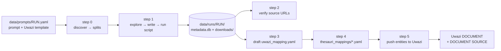

# browser-agent

LLM-driven browser scraper that turns a natural-language task into a
reviewed, reproducible Python script, harvests documents + metadata into
one SQLite store, and uploads the result to a Uwazi instance.

Two halves, both driven by the same per-run artifacts:

1. **Scrape** (`step_0` → `step_1`) — an agent splits the task, explores
   the live site, emits a script per chunk, smokes and executes it.
   Output: `metadata.db` rows + downloaded files.
2. **Upload** (`step_3` → `step_5`) — an LLM drafts the Uwazi mapping,
   the thesauri are matched, and a deterministic pusher creates entities
   (already-present rows are skipped). No LLM touches the push itself.

`step_2` sits between them as a deterministic, LLM-free coverage check.



## Setup

Requirements: Python 3.12, Chromium at `/usr/bin/chromium`, network
access to the LLM provider and to Uwazi.

```bash
uv sync                     # creates .venv and installs the editable package
```

`src/browser_agent/configuration.py` reads `.env` at import time. Minimum:

```ini
# LLM provider: LLM_PROVIDER in configuration.py is one of
# ollama | opencode | openrouter; set the matching key.
OPENCODE_ZEN_API_KEY=...
# OPENROUTER_API_KEY=...
# OLLAMA_API_KEY=...

# Uwazi instance + credentials (read by every drivers/step_3..5)
UWAZI_URL=https://global-rep.uwazi.io
UWAZI_USER=gabo
UWAZI_PASSWORD=...

# optional
ZENDRIVER_HEADLESS=false          # false = watch the browser work
CHROMIUM_WINDOW_POSITION=2560,0
NOPECHA_ENABLED=false             # captcha extension, see adapters/nopecha_extension.py
SCRAPER_RUN_TIMEOUT_S=21600       # per-script hard timeout (step 1 executor)
```

Every driver is a module (no CLI flags — configuration lives in constants
and in the run YAML, per `AGENTS.md`):

```bash
.venv/bin/python -m browser_agent.drivers.<driver>
```

Activate a run by editing the two-line `data/active_run.yaml`:

```yaml
active_run: HRC_supplementary_documents   # -> data/prompts/HRC_supplementary_documents.yaml
active_flow: 1-12                         # split prefixes step 1 / step 5 operate on
```

`data/prompts/<run>.yaml` is the run definition (`domain/run_config.py`):

```yaml
template: DOCUMENT                        # Uwazi template to map onto
scraper_registry_template: DOCUMENT SOURCE # second template, one row per scraped file
scraper_date_property: Uploaded Date
scraper_document_relationship: Related Document
scraper_document_hash: File Hash
parallel_runners: 6                       # download tabs for the emitted script
expected_source_urls:                     # checked by step 2
  - https://documents.un.org/api/symbol/access?s=A/HRC/2/L.20&l=es
prompt: |
  # Goal
  Download the documents ... log metadata per document variant ...
```

The prompt YAML is copied into `data/runs/<run>/<run>.yaml` at the first
step that touches the run, so each run folder keeps a snapshot of what
was asked.

## Demo run: OHCHR HRC supplementary documents

`data/` already contains a finished example — everything below can be
run against it without re-scraping.

| Artifact | Value |
| --- | --- |
| Prompt | `data/prompts/HRC_supplementary_documents.yaml` |
| Splits | 12 folders, `data/runs/HRC_supplementary_documents/flow/N_*` |
| DB rows | 16,266 (`metadata.db`, 12 `core_task_slug`s) |
| Files | 13,260 PDF + 105 DOC/DOCX + 1,861 page HTML, `downloads/` (≈2.3 GB) |
| Download status | 13,235 `downloaded`, 45 `failed`, 2,986 `permanently_failed` |
| Mapping | `mappings/uwazi_mapping.yaml` (27 properties, registry flow on) |
| Thesauri | `thesauri_mappings/{document_type,language,languages,status,validation}.yaml` |

### 1. Scrape

```bash
# Split the whole task into WHAT-scoped chunks. Incremental: rerun to add
# newly discovered pages. Writes flow/N_name/{prompt.md,split.json}.
.venv/bin/python -m browser_agent.drivers.step_0_discover_task

# Run the splits named by active_flow: explore → writer → lint/smoke →
# execute → independent verifier. Strictly sequential, resumable.
.venv/bin/python -m browser_agent.drivers.step_1_run_prompts
```

Each split folder is self-contained:

```
flow/1_session_2_5/
├── prompt.md                     # this chunk's scope
├── split.json                    # page_family, covered_paths, order
├── state.json                    # status/attempts/emitted scripts
├── scripts/                      # emitted .py + .json sidecar + script_tools/
├── logs/{run.log,script_0_live.log}
├── verification/{verification_report,reconciler_inventory}.{md,json}
├── smoke/metadata.db  scratch/   # smoke run DB, validation scratch dir
└── debug/llm/                    # agent transcripts
```

`profile/` and `profile_builder/` (Chromium user-data dirs) live here too
while the split runs and are deleted on exit.

Example: `flow/1_session_2_5/scripts/2026_09_07__hrc_sessions_2_5_supplementary_docs__164800.py`
walks sessions 2–5, classifies UN symbols, downloads EN/ES variants and
calls `save_record(core_id, {...})`. Every script writes into the **run
root** `downloads/` and `metadata.db` (the executor injects
`BROWSER_AGENT_SAVE_RECORD_DB_PATH` and `BROWSER_AGENT_TASK_SLUG`), so
splits never diverge. Its verification report ends with
`captured=5 failed=0` on the expected URLs and a reconciler inventory of
650 DB rows / 641 files on disk for that chunk.

Inspect what was captured (interactive: `core_pdf_filename` substring,
`?` lists filenames, `*` dumps all, empty input quits):

```bash
.venv/bin/python -m browser_agent.drivers.view_metadata
```

A row in `metadata.db` looks like this (one per document variant):

```json
{
  "language": "English",
  "document_ref": "A/HRC/2/9/Corr.1",
  "document_category": "Session Reports",
  "title": "A/HRC/2/9/Corr.1",
  "file_type": "pdf",
  "core_file_url": "https://documents.un.org/api/symbol/access?s=A/HRC/2/9/Corr.1&l=en",
  "core_source_page_url": "https://www.ohchr.org/en/hr-bodies/hrc/regular-sessions/session2/regular-session",
  "core_pdf_filename": "pdf_ec84c14df031.pdf",
  "core_download_status": "downloaded"
}
```

`core_*` fields are scraper-managed; everything else was chosen by the
prompt and is what the mapping later reads.

### 2. Verify coverage (optional, no LLM)

```bash
.venv/bin/python -m browser_agent.drivers.step_2_verify_expected_sources
```

Checks every `expected_source_urls` entry of the active run against
`metadata.db`, prints a table and writes
`data/runs/<run>/probe_verification_report.json`. Exit code 1 when any
URL is missing. For the demo run both HRC URLs are absent from the
supplementary-document subset, so it reports `failed=2` — that is the
run being narrower than the check, not a scraper bug.

### 3. Draft the Uwazi mapping

```bash
.venv/bin/python -m browser_agent.drivers.step_3_propose_mapping
```

Sends the live template of `run.template` plus a catalog of the
`metadata.db` fields to the LLM and writes
`data/runs/<run>/mappings/uwazi_mapping.yaml`. It never pushes and never
mutates the DB; the human is the gate. Then **edit the YAML** — that is
the contract step 5 executes.

Shape (`domain/uwazi_mapping.py`), trimmed from the demo run:

```yaml
version: 3
template: DOCUMENT
default_language: en
identity:                       # how to detect an already-uploaded row
  key_field: core_file_url
  key_property: source_url
  select_filtering_name: document_type
  select_filtering_options: ["HRC: Resolution", "Decision", "Session Report"]
publish: false                  # keep created entities as drafts
upload_pdf: true                # attach the local PDF/HTML when present
registry_template: DOCUMENT SOURCE
scraper_date_property: Uploaded Date
scraper_document_relationship: Related Document
scraper_document_hash: File Hash
properties:
- name: title                   # entity title, not metadata
  type: title
  source: title
- name: document_ref
  type: text
  source: document_ref
- name: document_type           # select backed by a thesaurus
  type: select
  required: true
  source: document_category     # crawl values, substituted in step 4
- name: languages
  type: multiselect
  source: language
- name: source_url
  type: link
  source: core_file_url
- name: validation
  type: select
  default_value: Pending        # constant when source is null
- name: related_document        # filled by the pusher, not by the row
  type: relationship
  template_name: [DOCUMENT SOURCE]
```

`source` may be a list (first non-empty wins) and `type: file` targets the
primary file. Property types come from `domain/field_type.py`.

### 4. Match thesaurus values

```bash
.venv/bin/python -m browser_agent.drivers.step_4_validate_data
```

Reads the mapping + DB rows + live Uwazi thesauri, then for every
select/multiselect/relationship property writes one
`thesauri_mappings/<property>.yaml` (deleted file ⇒ regenerated) and
prints a "missing from thesaurus" report, a `default_value` check, and an
upload-validation report (existing entities, CREATE/UPDATE/SKIP counts,
per-row issues such as an empty title or a missing PDF). Review the YAMLs:

```yaml
property_name: document_type
thesaurus: Document Types
thesaurus_id: 69f3cf1a4be7d711a8e5f37a
entries:
- crawl_value: NGO Written Statements   # value in metadata.db
  uwazi_value: NGO Written Statement    # canonical Uwazi value
  needs_review: false
  occurrences: 787
```

### 5. Upload to Uwazi

```bash
.venv/bin/python -m browser_agent.drivers.step_5_upload_to_uwazi
```

No LLM: selects the `metadata.db` rows whose `core_task_slug` matches the
splits named by `active_flow`, substitutes thesaurus values, resolves each
row's local file, and creates a `DOCUMENT` entity per row (plus one
`DOCUMENT SOURCE` registry entity per file when `registry_template` is
set, linked through `scraper_document_relationship` with the SHA-256 in
`scraper_document_hash`). Rows already present on the instance are
skipped, never updated. It prints:

```
active_flow 1-12 resolved task slugs: ...
Plan rows: 16266
Plan counts: {'create': ..., 'create_registry_only': ..., 'skip': ...}
Pushing ... rows to Uwazi...
Apply result:
  en: {'create': ...}
  skips: ... / skip reasons: already_on_registry=...
```

Skip reasons: `already_on_registry` (registry flow, key already there),
`already_on_uwazi` (no registry template, key already there),
`no_file_url` (row has no `core_file_url`).

The plan build downloads the instance's existing entities for
`identity.key_property`, one search chain per value of
`identity.select_filtering_name`. Uwazi caps a single search at 10,000
results, so if one filter option already holds more entities than that,
`step_4` (upload validation) and `step_5` fail with
`Result window is too large`. Narrow `select_filtering_options` for that
instance.

Dry run without touching the instance — set `push: false` in the run YAML
(a `RunConfig` field, read by the apply driver), rerun the same command;
the executor then only prints the plan
(`drivers/apply/apply_plan_executor.py`).

Wipe a template between experiments. **This deletes data**: the module
constants at the top of the file drive it, and `DELETE_ENTITIES` is `True`
by default, so running it starts the wipe; `WIPE_TEMPLATES` lists the
templates it empties. It prints the live thesaurus list first (a credential
smoke test), then asks for a `y/N` confirmation:

```bash
.venv/bin/python -m browser_agent.drivers.uwazi_delete_entities
```

## Resuming, retrying, running unattended

- **Resume:** rerun the exact same module. Step 0 keeps existing splits and
  only appends new ones; step 1 resumes from each split's `state.json`;
  step 5 skips rows whose `identity.key_field` value already exists on
  Uwazi under `identity.key_property`.
- **Ctrl-C / kill:** handled by `drivers/signal_guard.py`; the run prints
  "rerun the same command to resume". Chromium is reaped and the profile
  deleted on the next launch.
- **Headless box:** `systemd/step0-scraper.service` runs step 0 with
  `Restart=on-failure`, reading secrets from `~/.config/browser-agent/env`;
  enable with `systemctl --user enable --now step0-scraper` plus
  `loginctl enable-linger $USER`.
- **When something fails:** read `data/runs/<run>/debug/README.md` (written
  on exit: outcome, run config, subtask table, "Where everything lives",
  "How to debug"), then `logs/run.log`, `flow/<split>/state.json`, and
  `debug/llm/*.json` for the exact prompts/tool results the agent saw.

## Alternative: single-flow driver

`step_discarted_run_prompt.py` is the older one-shot pipeline (planner →
subtask pipeline → final verification) writing `scripts/` and
`verification_report.*` directly under the run folder — the layout of the
`IACHR_*` and `corteidh_*` runs in `data/runs/`. The split flow above
supersedes it for large tasks; both feed the same `metadata.db` schema.

```bash
.venv/bin/python -m browser_agent.drivers.step_discarted_run_prompt "Visit ... and save every document"
.venv/bin/python -m browser_agent.drivers.step_discarted_run_prompt --stdin < task.txt
```

## Layout

```
data/
├── active_run.yaml              # active_run + active_flow selector
├── prompts/<run>.yaml           # task + Uwazi template settings (source of truth)
├── runs/<run>/
│   ├── <run>.yaml               # prompt snapshot taken at execution time
│   ├── metadata.db              # table metadata (core_id PK, core_task_slug, data JSON)
│   ├── downloads/               # pdf_*.pdf, doc_*.docx, html_*.html
│   ├── flow/N_name/             # step 0/1 split folders
│   ├── mappings/uwazi_mapping.yaml
│   ├── thesauri_mappings/*.yaml
│   ├── logs/  debug/
│   └── probe_verification_report.json
src/browser_agent/
├── drivers/step_*.py            # the pipeline entry points
├── drivers/flow/                # split flow: orchestrator, emitter, executor
├── use_cases/                   # propose/push/mapping/verification logic
├── domain/                      # pydantic models (one per file)
├── adapters/                    # browser, LLM, PDF, Uwazi client factory
└── script_tools/                # helpers copied next to emitted scripts
```

## Development

```bash
just formatter        # ruff format
just test             # pytest (tests/ — scenario suite against scripts/fixture_server.py)
```

The fixture server (`python scripts/fixture_server.py`, port 8765) serves
deterministic local pages for the scenario tests; `data/prompts/manual_concurrency.yaml`
is a ready-made run pointing at it.
